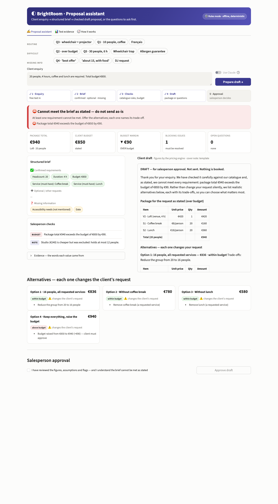

# BrightRoom · enquiry → feasible draft proposal

HEC MSc DSAIB 2026–27 · AI Solution Sprint · **Case 02 — From a client enquiry to a feasible proposal**

A reusable assistant for BrightRoom's salesperson. It turns a free-text client enquiry into:

1. a **structured brief**: confirmed requirements / optional preferences / missing information, each with the
   quote it came from;
2. a **status the salesperson sees first**: 🟢 feasible · 🟡 provisional (labelled assumptions) · 🔴 cannot meet the
   brief · 🔵 clarification needed;
3. a **draft proposal** with an itemised, code-calculated package, or explicit alternatives with their trade-offs,
   or the questions to ask, always marked *DRAFT — for salesperson approval*.

**Design rule:** GenAI handles language (reading messy enquiries, writing the cover paragraph). Code handles
everything that must be exactly right: venue choice, capacity, accessibility, duration, prices, totals, budget check
and alternatives. See [APPENDIX.md](APPENDIX.md) for the design rationale and test evidence.

## Run it

```bash
python3 -m venv .venv && source .venv/bin/activate
pip install -r requirements.txt

streamlit run app.py                       # salesperson UI
python cli.py "20 people, 4 hours, coffee and lunch are required. Total budget €850."
python -m pytest -q                        # 37 tests (engine, extractor, guardrail, LLM mock, MCP)
python -m eval.run_eval --offline          # 16 designed tests  -> eval/results_prototype.md
python -m eval.run_eval --offline --cases heldout_cases.json   # independent set 1
python -m eval.run_eval --offline --cases blind2_cases.json    # independent set 2
```

**Modes**
- **Rules-only (default when no key):** deterministic, free, offline. Regex extractor (English + French).
- **Claude mode:** `export ANTHROPIC_API_KEY=...` (optional `BRIGHTROOM_MODEL`, default `claude-opus-5`). Claude
  extracts the brief with a strict JSON schema, and every number must be backed by a verbatim quote from the
  enquiry. The result is cross-checked against the rule extractor, and disagreements are shown to the salesperson.
  Claude also writes the cover paragraph, which is audited for invented euro amounts, booking/date promises,
  discounts and unlisted services; on any violation the template is used instead. `BRIGHTROOM_OFFLINE=1` forces
  rules-only. Any API error falls back to rules.
- `python -m eval.baseline` regenerates the single-prompt baseline through the API.



Demo deep links: `http://localhost:8501/?case=T02` loads and runs a test enquiry (any id from `eval/cases.json`).

## MCP server — use the engine from Claude

`brightroom/mcp_server.py` exposes the deterministic engine over the Model Context Protocol, so Claude Desktop,
Claude Code or any MCP host can run the conversation while **every number comes from the engine**.

| Tool | What it does |
|---|---|
| `analyse_enquiry(enquiry)` | enquiry → brief, status, itemised package, alternatives, questions, client draft |
| `price_brief(headcount, services_required, wheelchair_access, …)` | price a brief the host LLM extracted itself (typed, validated: services ∈ S1–S4) |
| `check_draft(text, enquiry)` | audit any message for invented € amounts, booking/date promises, discounts, unlisted services |
| `get_catalogue()` | the approved catalogue (also as resource `brightroom://catalogue`) |
| prompt `proposal_workflow(enquiry)` | step-by-step instructions: analyse → write → check → present as draft |

All tools are read-only. **Claude Code:** the repo ships `.mcp.json`; open the folder and approve the `brightroom`
server. **Claude Desktop:** add to `claude_desktop_config.json`:

```json
{ "mcpServers": { "brightroom": {
    "command": "/ABSOLUTE/PATH/brightroom-ai/.venv/bin/python",
    "args": ["-m", "brightroom.mcp_server"],
    "env": { "PYTHONPATH": "/ABSOLUTE/PATH/brightroom-ai" } } } }
```

Then ask: *"Use the proposal_workflow prompt for: 20 people, 4 hours, coffee and lunch, budget €850."*

## Layout

```
brightroom/
  catalogue.py      approved catalogue + rules (single source of truth)
  brief.py          Brief dataclass (confirmed / optional / missing)
  extract_rules.py  deterministic extractor (offline; also cross-checks the LLM)
  llm.py            Claude: schema-constrained extraction + cover note (optional)
  engine.py         venue choice, pricing, constraint checks, status, alternatives
  draft.py          review sheet + client draft rendering, LLM-text guardrail
  pipeline.py       enquiry -> brief -> evaluation -> draft
  mcp_server.py     MCP server (tools, resource, prompt) over the same engine
  serialize.py      plain-dict views used by the MCP server
app.py              Streamlit UI (review + explicit approval step)
cli.py              command line
eval/               test cases, runner, baseline prompt + outputs, results
tests/              pytest (engine, extractor, guardrail, mocked LLM path, MCP server)
docs/               screenshots
DEMO_SCRIPT.md      4-minute demo video script
```

All company data, enquiries and records are fictional teaching material from the case. Additional test enquiries
are labelled as additions.
